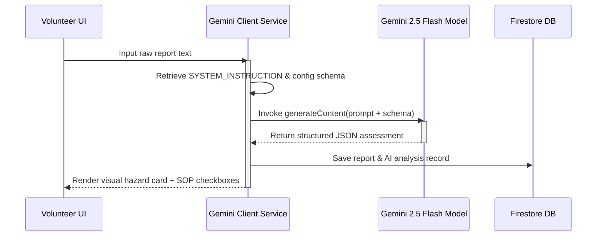

# StadiumMind - Project Specification

## 1. Product Vision

StadiumMind is a real-time Generative AI-powered operational assistant designed for FIFA World Cup volunteers. It transforms raw observation logs from the stadium ground into categorized hazard assessments and actionable Standard Operating Procedures (SOPs). Additionally, it translates conversations on-the-fly, helping volunteers manage complex crowd dynamics, resolve gate bottlenecks, and communicate with international visitors efficiently and safely.

---

## 2. Problem Statement

FIFA World Cup matches host over 80,000 visitors per stadium. Volunteers are the primary interface for crowd control and guest queries, yet they often face:

- **Chaotic Influxes:** Rapid queue pile-ups at ticket turnstiles and gates.
- **Language Barriers:** Communication gaps with international fans.
- **Slow Response Times:** Delay in knowing the correct safety protocol when gate pressure builds.
- **Disconnected Admin Dashboards:** Existing systems are for dispatchers, leaving the volunteer on the ground without instant, localized guidance.

---

## 3. User Persona

### Primary Persona: FIFA World Cup Volunteer (Ground Marshal)

- **Role:** Gate usher, wayfinder, queue manager.
- **Environment:** High noise levels, high stress, outdoor/indoor terminal corridors.
- **Need:** High-contrast, glanceable UI; quick, bulleted step-by-step actions; offline/mock resilience.

---

## 4. User Journey

1. **Login:** Onboards anonymously via their smartphone by entering their designated sector.
2. **Observe:** Identifies a bottleneck (e.g., Gate C is gridlocked, visitors are pushing).
3. **Report & Assess:** Volunteers input the observation. StadiumMind’s Gemini safety agent assesses the situation instantly.
4. **Action:** The volunteer receives a clear hazard level (e.g., HIGH RISK) and three specific checkboxes (SOPs) to execute (e.g., "Direct overflow to Gate D", "Inform Sector Coordinator").
5. **Translate:** Translates foreign visitors' requests instantly to solve wayfinding issues.

---

## 5. AI Workflow



---

## 6. Screen Flow

- **Dashboard Screen:**
  - Top: Stadium sector info & Sync status.
  - Left: Interactive navigation tabs (Crowd, Translate, Info).
  - Main: Live feed of active incidents & incident report form.
- **Crowd Assessor Form:** Submits text reports and displays the real-time AI assessment card.
- **Multilingual Translator View:** Two-way language helper cards.

---

## 7. Tech Stack

- **Framework:** React 19 + Vite 8
- **Language:** TypeScript
- **Styling:** Tailwind CSS v4 (CSS-first config)
- **Routing:** React Router v6
- **Forms:** React Hook Form + Zod validation
- **Icons:** Lucide React

---

## 8. Google Services

- **Firebase Authentication:** Anonymous sign-in for zero-friction volunteer access.
- **Firebase Firestore:** Low-latency syncing of live crowd incident report logs.
- **Google GenAI SDK (`@google/genai`):** Model execution (`gemini-2.5-flash`) for safety risk evaluations and multilingual translation.

---

## 9. Folder Structure

```text
C:\Users\baris\OneDrive\Desktop\StadiumMind-AI-Volunteer-Copilot
├── .github/workflows/ci.yml       # GitHub Actions CI pipeline
├── .husky/pre-commit              # Git commit hook runner
├── docs/                          # Expanded Architecture and APIs
├── src/
│   ├── components/
│   │   ├── layout/                # Global layout frames (Header)
│   │   ├── shared/                # Cross-cutting UI (Spinners)
│   │   └── ui/                    # Reusable elements (Button)
│   ├── context/                   # Lightweight global states (UIContext)
│   ├── hooks/                     # Custom hook utils (useLocalStorage)
│   ├── router/                    # Route setups (routes.tsx)
│   ├── services/
│   │   ├── firebase/              # Firebase auth/firestore wrappers
│   │   └── gemini/                # Gemini client, mock files, prompts
│   ├── styles/                    # Globals, theme config, animations
│   ├── types/                     # Shared models (AlertLevel)
│   └── utils/                     # Utility string/date helpers (helpers.ts)
```

---

## 10. Acceptance Criteria

- **Quality Gates:** Zero ESLint warnings, TypeScript build passes with zero errors.
- **Responsive:** Fluid layout fits mobile screens, tablets, and desktop terminals.
- **Resilience:** Fall back to simulation mock mode if Firebase or Gemini variables are missing.
- **Git Hooks:** Blocks commits if code style or lint configurations fail.

---

## 11. Non-Functional Requirements

- **Performance:** App boots under 1.5 seconds locally.
- **Glanceability:** Dashboard colors match standard industry alert schemes (green/orange/red).
- **Security:** Anonymous tokens are securely cached locally.
