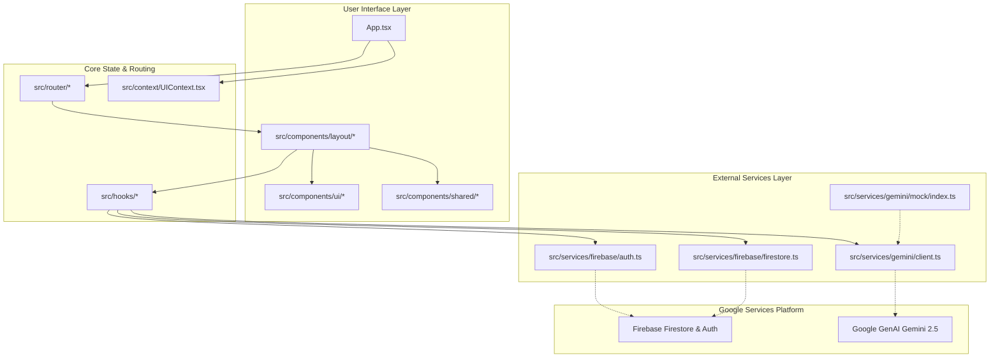

# StadiumMind Architecture

This document describes the software architecture and component design of the **StadiumMind AI Volunteer Copilot** application.

## System Overview

StadiumMind is structured as a lightweight, client-heavy React single-page application built on top of Vite and TypeScript. It utilizes Firebase for persistence and authentication, and Google GenAI SDK for intelligence.

## Directory Structure

- `src/components/ui/`: Presentation-only elements (buttons, inputs).
- `src/components/layout/`: Global structure templates (headers, wrappers).
- `src/components/shared/`: Cross-cutting helpers (loaders, boundary fallbacks).
- `src/context/`: React context states (UI drawer switches).
- `src/router/`: React Router routes config.
- `src/services/firebase/`: Firebase configuration, anonymous login wrappers, and collections.
- `src/services/gemini/`: Client initialization, operational prompt instructions, mock responses.
- `src/styles/`: CSS theme tokens, animations, and Tailwind directives.

## Design Decisions

1. **Vite + React + TypeScript:** Ensures rapid hot-reloading in development and robust static analysis.
2. **Tailwind CSS v4 CSS-First Customization:** Theme variables are configured within standard CSS files (`theme.css` and `animations.css`), decoupling styling configuration from complex JSON config files.
3. **Mock Fallback Strategy:** If environment variables (`VITE_GEMINI_API_KEY`, etc.) are missing, services fall back to simulating responses locally. This ensures smooth onboarding and local testing.
